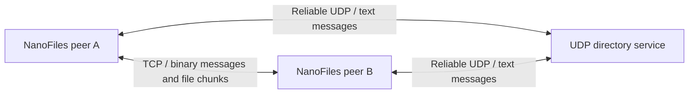

# NanoFiles P2P

NanoFiles is a command-line peer-to-peer file-sharing system written in Java. It uses a UDP directory service for peer discovery and a custom binary protocol over TCP for concurrent file transfer.

## Highlights

- Reliable stop-and-wait communication over UDP with timeouts and bounded retransmissions
- Text-based directory protocol with custom serialization and parsing
- Peer registration, discovery, and remote file listing
- Concurrent TCP server with one worker thread per client
- Custom binary peer-to-peer message protocol
- File lookup through SHA-1 hash prefixes
- Complete-file and chunk-based transfers
- Parallel download from multiple peers
- Reconstruction and SHA-1 integrity verification
- Handling of missing files, ambiguous hash prefixes, and interrupted requests

## Architecture



The directory maintains the active peer registry and can also expose its own shared files. Each NanoFiles process acts as a directory client and can become a concurrent TCP file server.

## Academic context and my contribution

NanoFiles began from a Java scaffold supplied for the Computer Networks course at the University of Murcia. The scaffold contained the application entry points, command shell, utility classes, interfaces, class skeletons, and TODO specifications.

I was solely responsible for designing the four application-layer protocol state machines and implementing all required and optional networking functionality. This included reliable UDP communication, message serialization, directory operations, concurrent TCP serving, peer discovery, single-peer transfers, multi-peer chunk allocation and reconstruction, and SHA-1 integrity verification.

This repository is a cleaned presentation copy. Course handouts, compiled binaries, and generated stress-test data are intentionally excluded. Resolved course-task markers are retained in the source to show which sections were implemented from the scaffold.

## Suggested review path

These files contain the central implementation:

- [`DirectoryConnector.java`](src/es/um/redes/nanoFiles/udp/client/DirectoryConnector.java) - reliable UDP requests, retries, and directory operations
- [`NFDirectoryServer.java`](src/es/um/redes/nanoFiles/udp/server/NFDirectoryServer.java) - directory protocol and peer registry
- [`DirMessage.java`](src/es/um/redes/nanoFiles/udp/message/DirMessage.java) - text-message serialization and parsing
- [`PeerMessage.java`](src/es/um/redes/nanoFiles/tcp/message/PeerMessage.java) - custom binary protocol
- [`NFServer.java`](src/es/um/redes/nanoFiles/tcp/server/NFServer.java) - concurrent TCP service and file-transfer logic
- [`NFControllerLogicP2P.java`](src/es/um/redes/nanoFiles/logic/NFControllerLogicP2P.java) - single- and multi-peer download orchestration

## Requirements

- JDK 17 or later
- No external dependencies

## Build

### Windows PowerShell

```powershell
.\scripts\build.ps1
```

### Linux or macOS

```bash
bash scripts/build.sh
```

Both scripts compile the project into `build/classes`. The equivalent manual command is:

```powershell
New-Item -ItemType Directory -Force build\classes | Out-Null
$files = Get-ChildItem -Recurse -Filter *.java .\src |
    Select-Object -ExpandProperty FullName
javac --release 17 -encoding UTF-8 -d build\classes $files
```

## Run a local demonstration

Start the UDP directory service:

```powershell
java -cp build/classes es.um.redes.nanoFiles.application.Directory -dir demo/directory
```

In another terminal, start a serving peer:

```powershell
java -cp build/classes es.um.redes.nanoFiles.application.NanoFiles demo/peer-a
```

Within its shell:

```text
nick peer-a
ping
serve
```

Start a second peer in another terminal:

```powershell
java -cp build/classes es.um.redes.nanoFiles.application.NanoFiles demo/peer-b
```

Useful commands include:

```text
ping
peers
peerfiles peer-a
peerdl peer-a <hash-prefix>
dirfiles
dirdl <hash-prefix>
help
quit
```

Use `peerdl * <hash-prefix>` to distribute a download across every registered peer serving the same SHA-256 hash. The directory can also be started with `-loss 0.3` to exercise UDP retransmission behavior.

## Protocol design

The [`docs/state-machines`](docs/state-machines) directory contains the four state-machine diagrams used to design the directory client, directory server, peer client, and peer server protocols. They cover retries, timeouts, multipart responses, registration state, ambiguous hashes, chunk sequencing, reconstruction, and integrity verification.

## Current scope

NanoFiles is an educational networking system rather than production file-sharing software:

- the directory listens on UDP port `6868`;
- file servers listen on TCP port `10003`;
- the default directory host is `localhost`;
- simultaneous serving peers on one host require configurable TCP ports;
- the protocol does not provide authentication or encryption;
- multi-peer demonstrations are intended for peers running on separate hosts or isolated network environments.

## Attribution

Course scaffold and utility code remain attributable to their original authors. The implementation and protocol design described above are Jorge Muñoz Ibañez's work. See [`NOTICE.md`](NOTICE.md) for details.
